<div align="center">


# Stockroom

**Inventory & purchase-order ERP for small shops and cafés — know what's in the back room, reorder before it runs out.**

<a href="https://stockroom-erp.onrender.com"></a>

[Try it live](#try-it-in-30-seconds) · [Screenshots](#screenshots) · [Features](#features) · [How it works](#how-it-works) · [Run locally](#run-it-locally) · [Skills](#skills-demonstrated)

<br>


</div>

<br>

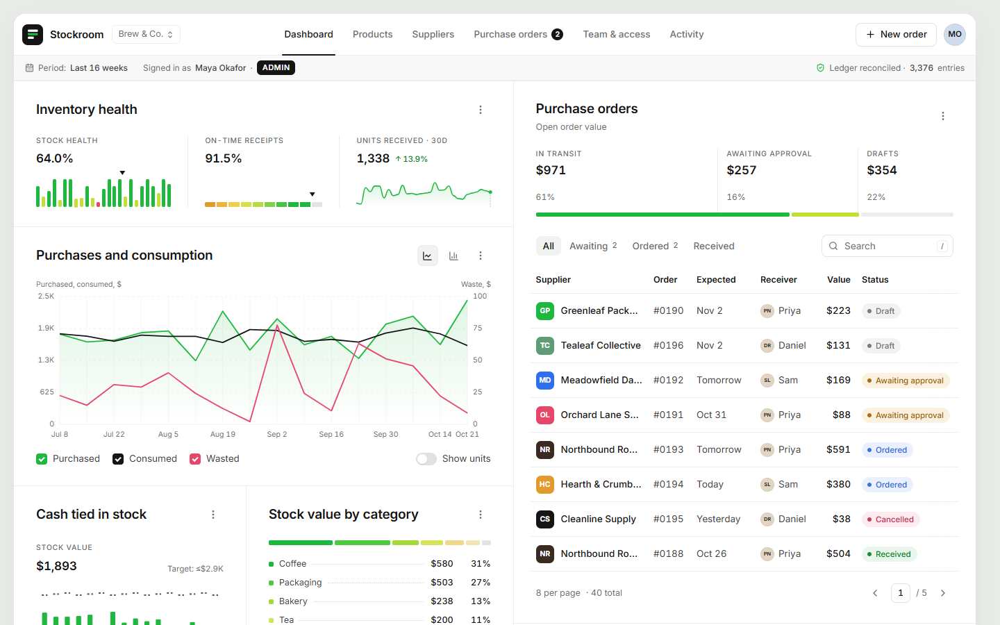

## Why it exists

A small retail shop or café lives between two mistakes: **order too much and cash sits on shelves; order too little and you lose sales.** Stockroom tracks what you have, who you buy from and what's on order, suggests what to reorder, and — the core idea — **only changes stock when goods actually arrive**, in a single all-or-nothing transaction. Every request is checked against **strict role-based access control** on the server.

---

## Try it in 30 seconds

1. Open **[stockroom-erp.onrender.com](https://stockroom-erp.onrender.com)**.
2. On the sign-in page, click one of the **demo role** buttons — no typing needed.
3. Sign out from the avatar menu (top right) and try another role to see how the app changes.

| Role | Email | Password | What to try |
|---|---|---|---|
| **Admin** (owner) | `admin@stockroom.app` | `admin123` | Approve a pending order, change someone's role in **Team & access** |
| **Manager** | `manager@stockroom.app` | `manager123` | Draft orders from **Reorder suggestions**, then try to approve your own (separation of duties blocks it) |
| **Staff** | `staff@stockroom.app` | `staff123` | Receive the order assigned to you and watch stock count up — note that prices are hidden |

> [!NOTE]
> The demo runs on Render's free plan: the first visit after it has been idle takes about 30 seconds to wake up, and the demo data resets to a fresh copy whenever the service restarts. Anything you create there is temporary.

---

## Screenshots

<table>
  <tr>
    <td width="50%">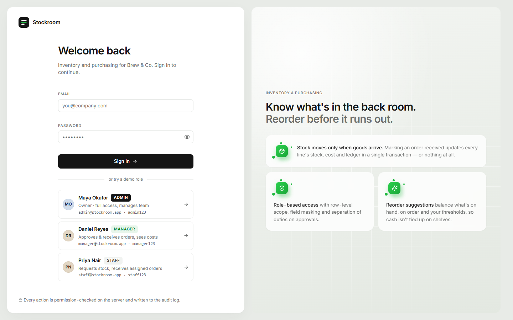<br><sub><b>Sign in</b> — one-click demo roles, clear errors, show/hide password</sub></td>
    <td width="50%">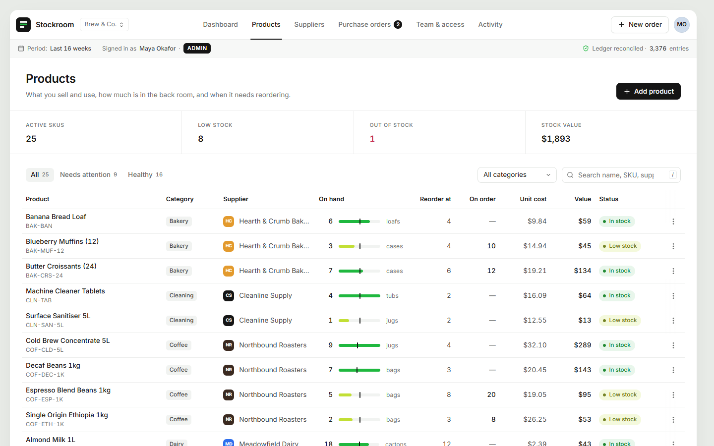<br><sub><b>Products</b> — stock meters with reorder-point markers</sub></td>
  </tr>
  <tr>
    <td>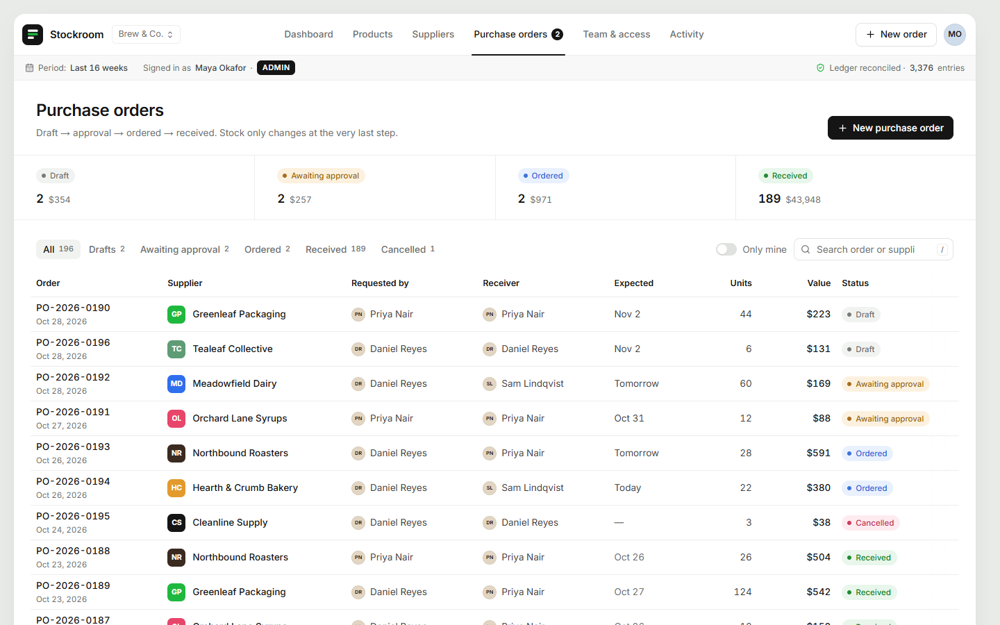<br><sub><b>Purchase orders</b> — filters live in the URL</sub></td>
    <td>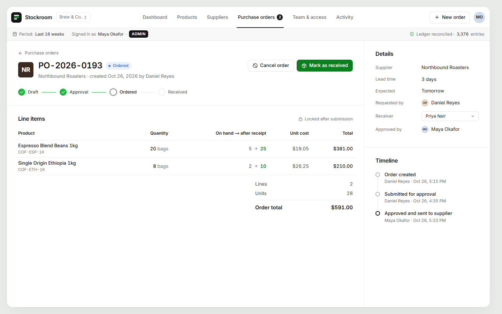<br><sub><b>Order detail</b> — see stock before → after receipt</sub></td>
  </tr>
  <tr>
    <td>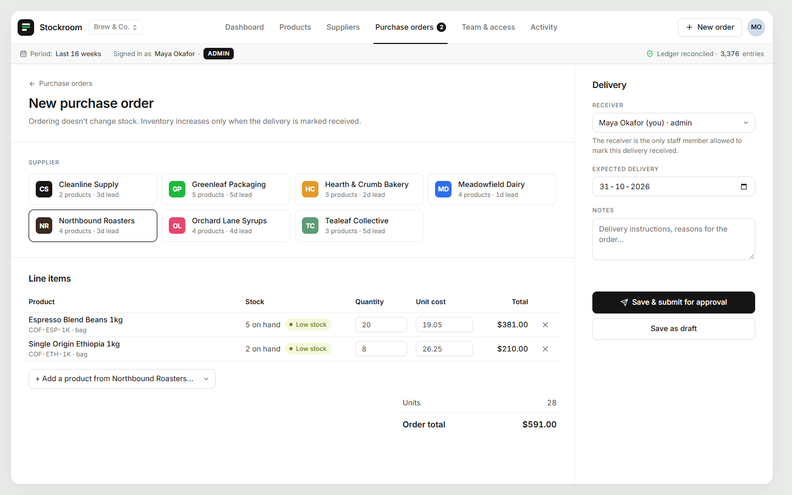<br><sub><b>New order</b> — add all low-stock items in one click</sub></td>
    <td>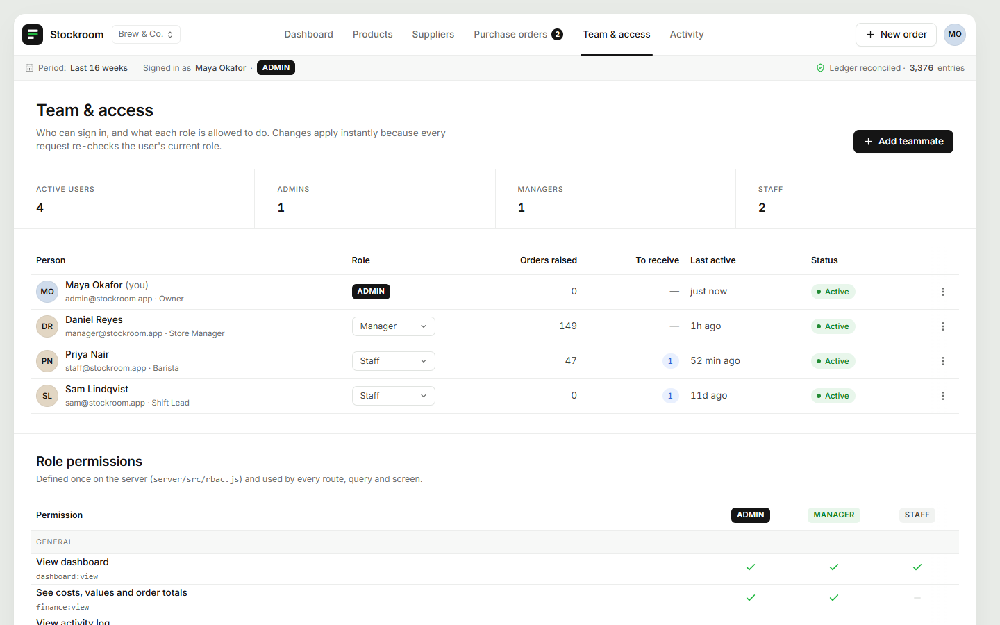<br><sub><b>Team & access</b> — roles and the live permission matrix</sub></td>
  </tr>
</table>

<details>
<summary><b>On a phone</b> (click to expand)</summary>
<br>
<p>
  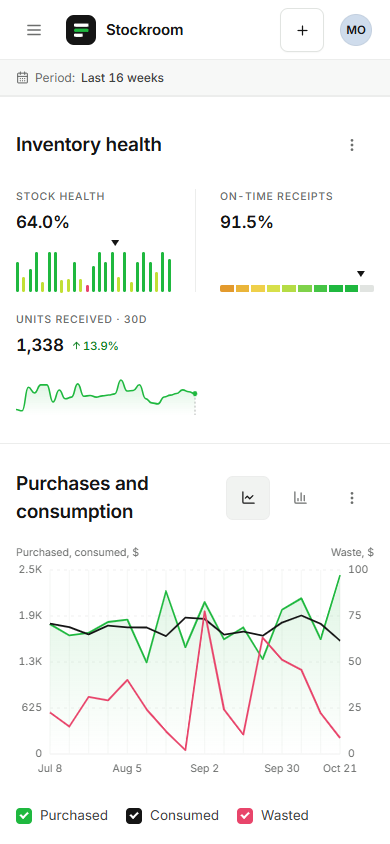
  &nbsp;&nbsp;
  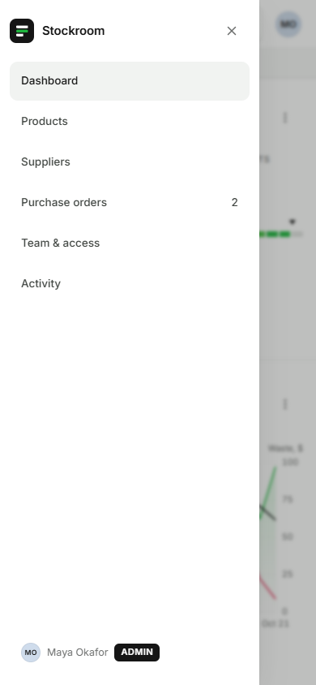
</p>
Below 1024px the tab bar becomes a slide-out menu, tables scroll inside their cards with a sticky first column, and every control is at least 44×44px.
</details>

---

## Features

| Module | What it does |
|---|---|
| **Dashboard** | Stock health, on-time receipts, units received, purchases vs. consumption vs. waste, cash tied up in stock against a target, value by category, the order pipeline and reorder suggestions. Every chart can be read from the keyboard or shown as a data table. |
| **Products** | Stock on hand, reorder point and batch size, moving-average unit cost, and an append-only **stock history** per product (receipts, usage, waste, count corrections). |
| **Suppliers** | Contacts, lead times, payment terms, open orders and 90-day spend. |
| **Purchase orders** | `draft → awaiting approval → ordered → received` (or `cancelled`), with an assigned receiver, a full timeline, and one-click drafts from reorder suggestions. |
| **Team & access** | Add teammates, change roles, deactivate accounts, reset passwords, and view the permission matrix. Admin only. |
| **Activity** | Append-only audit log of every sign-in and change, grouped by day. |

---

## How it works

### Architecture

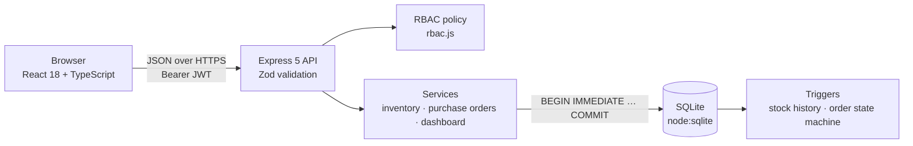

One Node service does everything: the Express API serves the built React app as well as the JSON endpoints, and SQLite runs in-process through Node's built-in `node:sqlite` (no database server, no native build step). Requests are validated with Zod, checked against the role policy, and every change runs inside a single database transaction.

### Purchase order lifecycle

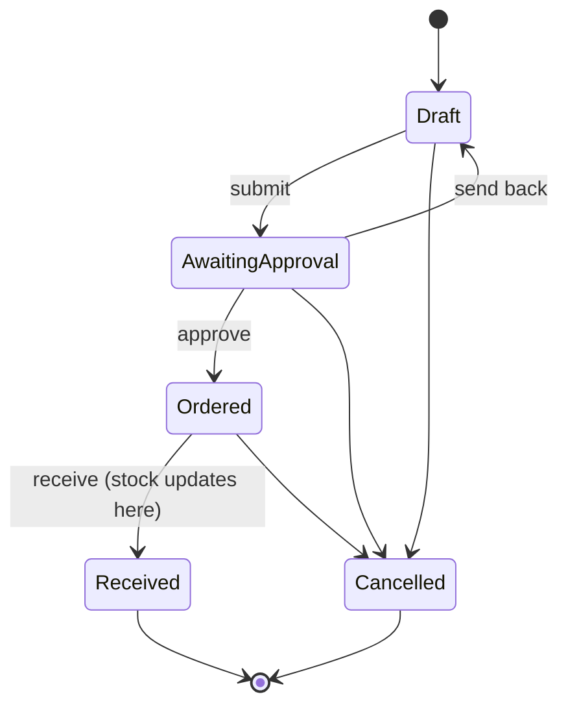

An order starts as a draft, goes to a manager for approval, is placed with the supplier, and is finally received. These transitions are enforced by a **database trigger**, not just by the app. Received and cancelled orders are frozen, and line items lock once an order is submitted.

### Receiving is atomic

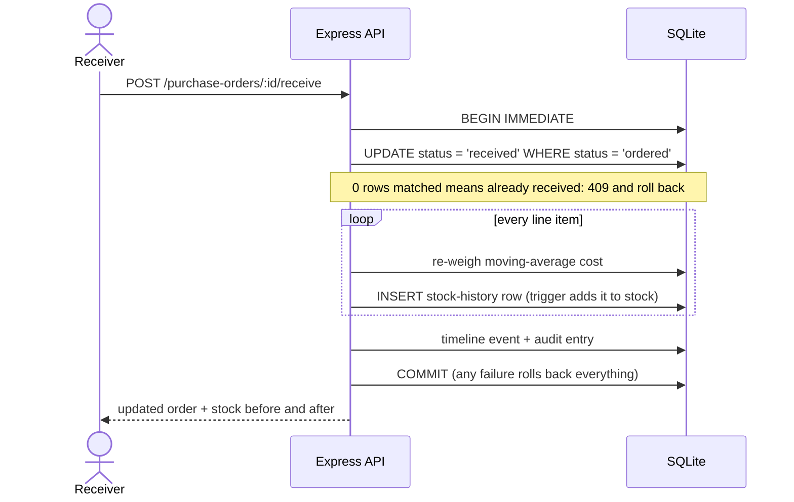

Stock changes **only** when an order is received, and the whole receipt succeeds or fails together. A double-click or two people receiving at once can't add stock twice. The database backs this up on its own ([`schema.sql`](server/src/schema.sql)):

- `products.stock` can only change through a stock-history insert; a trigger rejects direct edits.
- Stock-history rows can't be edited or deleted, and `CHECK (stock >= 0)` aborts anything that would go negative.
- The sub-bar shows a live check that every product's stock equals the sum of its history.

### Role-based access control

Defined once in [`server/src/rbac.js`](server/src/rbac.js) and enforced **on the server** in four layers:

| Layer | Example |
|---|---|
| **Permissions** (route guards) | Staff calling `POST /api/products` gets `403 missing products:manage` |
| **Row-level scope** | Staff only see orders they raised or were assigned to receive; anything else is a `404` |
| **Per-record policy** | Only the assigned receiver (or a manager) can receive. **Separation of duties:** a manager can't approve an order they raised; the owner can |
| **Field masking** | Unit costs, stock values and order totals are removed from API responses for staff |

The browser only receives the permission list and each order's `allowed_actions` so it can hide buttons — it is never trusted. Role changes and deactivations apply on the very next request, because the user is re-read from the database every time.

<details>
<summary><b>Full permission matrix</b></summary>
<br>

| | Admin | Manager | Staff |
|---|:-:|:-:|:-:|
| View products, suppliers, dashboard | ✓ | ✓ | ✓ |
| See costs and order values | ✓ | ✓ | — |
| Create purchase requests | ✓ | ✓ | ✓ |
| Approve / send back orders | ✓ | ✓ (not their own) | — |
| Receive orders | any | any | assigned only |
| Manage products & suppliers | ✓ | ✓ | — |
| Stock-count corrections | ✓ | ✓ | — |
| Manage users & roles, archive records | ✓ | — | — |

</details>

<details>
<summary><b>Sign-in & sessions</b></summary>
<br>

- Passwords are bcrypt-hashed; sessions are 8-hour JWTs.
- Failed sign-ins are limited per IP + email (8 per 10 minutes) with a clear "try again in N minutes" message.
- If the server is briefly unreachable, the app keeps you signed in and reconnects automatically instead of signing you out.
- An expired session returns you to sign-in with a notice, then back to the page you were on.
- In production the server refuses to start without a `JWT_SECRET`.

</details>

---

## Quality & accessibility

Measured with a custom headless-Chrome audit across **9 pages × 7 screen widths × 3 roles (175 runs)** — full write-up in [docs/ux/REPORT.md](docs/ux/REPORT.md).

| Check | Result |
|---|---|
| Layout shift (CLS) | **≤ 0.004** on every page and interaction (worst was 0.495 before the UX pass) |
| Screen widths | No sideways scrolling from **360px to 1920px** |
| Touch targets | Every control **≥ 44×44px** on phones and tablets |
| Contrast | All text meets **WCAG AA** (4.6–5.5:1) |
| Keyboard | Sign in → create → approve → receive works **keyboard-only** (20/20 steps), with visible focus and focus-trapped dialogs |
| Motion | Animates only `transform`/`opacity`; respects **reduced-motion** |
| Performance | Route-level code splitting (initial JS 290 KB → 254 KB), hover prefetch, virtualized long lists |
| Console | **Zero** errors or warnings |

---

## Run it locally

Requires **Node.js 22.13+**.

```bash
git clone https://github.com/rrushikeshp89/stockroom-erp.git
cd stockroom-erp
npm install     # one install for the API and the web app (npm workspaces)
npm run dev     # API on http://localhost:5180, web app on http://localhost:5173
```

Open **http://localhost:5173** and pick a demo role. The database creates and seeds itself on first run with about 26 weeks of simulated trading, replayed through the real stock-history logic.

| Command | What it does |
|---|---|
| `npm run dev` | Start the API and web app with live reload |
| `npm test` | Run the integrity and access-control tests |
| `npm run seed` | Reset the database to fresh demo data |
| `npm run build` | Type-check and build the web app |
| `npm start` | Serve the API and built app in one process (production) |

<details>
<summary><b>Project structure</b></summary>
<br>

```text
server/
  src/schema.sql            tables, constraints, integrity triggers
  src/rbac.js               roles, permissions, row scope, order policy
  src/services/             stock history, purchase orders, dashboard
  src/routes.js             REST API (Zod-validated)
  src/seed.js               replays 26 weeks of trading through the real logic
  test/integrity.test.js    atomic receive, no double-receive, separation of duties, scoping, rollback
client/
  src/styles.css            design system (tokens, hairline grid, motion, responsive rules)
  src/components/           layout, hand-rolled SVG charts, UI kit
  src/pages/                dashboard, products, suppliers, orders, team, activity
tools/                      UX audit, before/after comparison, keyboard-only walkthrough
docs/ux/                    audit findings and before/after report
render.yaml                 Render blueprint (single web service)
```

</details>

<details>
<summary><b>Deploying your own copy</b></summary>
<br>

`render.yaml` deploys the app to [Render](https://render.com) as a single web service: in Render choose **New → Blueprint** and select this repository. Render generates `JWT_SECRET` for you, and every push to `main` redeploys automatically, as long as Render's GitHub app has access to the repository (GitHub → Settings → Applications → Render).

To run the production build anywhere else:

```bash
npm run build
NODE_ENV=production JWT_SECRET=your-long-random-secret npm start   # serves on $PORT (default 5180)
```

On Render's free plan the disk is temporary, so the demo database re-seeds whenever the service restarts. For permanent data, attach a persistent disk and point `DB_PATH` at it.

</details>

---

## Skills demonstrated

**Full-stack development**


**Security & data integrity**


**UX, accessibility & performance**


**Testing, tooling & delivery**


---

<div align="center">

Visual direction inspired by the <a href="https://dribbble.com/shots/27214723-Enterprise-Resource-Planning-B2B-SaaS-Dashboard">Enterprise Resource Planning dashboard concept by Conceptzilla on Dribbble</a>.

Built by **Rushikesh Panchal** · [@rrushikeshp89](https://github.com/rrushikeshp89)

</div>
