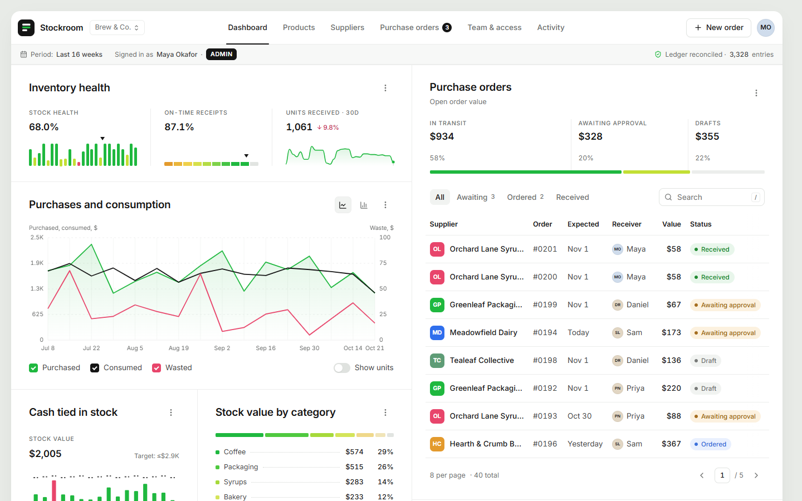

# Stockroom — Inventory & Purchase Order ERP

A small-business ERP for a cafe or retail shop that needs to know what's in the back room and when to reorder.
Ordering too much ties up cash; ordering too little costs sales. Stockroom tracks stock, suppliers and purchase
orders, suggests what to reorder, and enforces **strict role-based access control** on every request.

  

**Live demo:** _deploying — link added after the first Render deploy_



## Quick start

Requires **Node.js 22.13+** (uses the built-in `node:sqlite` — no native build step, no database server).

```bash
npm install     # one install for API + web (npm workspaces)
npm run dev     # API on :5180, web on :5173
```

Open http://localhost:5173. The database seeds itself on first run with ~26 weeks of simulated trading.
`npm run seed` resets it. `npm test` runs the integrity and RBAC test suite.

| Role | Email | Password |
|---|---|---|
| Admin (owner) | `admin@stockroom.app` | `admin123` |
| Manager | `manager@stockroom.app` | `manager123` |
| Staff | `staff@stockroom.app` | `staff123` |
| Staff | `sam@stockroom.app` | `staff123` |

The sign-in page also has one-click demo buttons for each role.

## Modules

- **Products** — what you sell/use, stock on hand, reorder point and batch size, moving-average unit cost, and an
  append-only stock ledger per product (receipts, usage, waste, count corrections).
- **Suppliers** — contacts, lead times, payment terms, open orders and 90-day spend.
- **Purchase orders** — `draft → pending approval → ordered → received` (or `cancelled`), with an assigned receiver,
  a full timeline, and one-click drafting from reorder suggestions.
- **Dashboard** — stock health, on-time receipts, purchases vs. consumption vs. waste, cash tied up in stock against a
  target, value by category, the PO pipeline and reorder suggestions.
- **Team & access** (admin) — add users, change roles, deactivate, reset passwords, and the live permission matrix.
- **Activity** — append-only audit log of every sign-in and change.

## Transactional integrity

Stock changes **only** when a purchase order is flipped to *Received*, and that flip is atomic
([`receivePO`](server/src/services/purchaseOrders.js)):

1. `UPDATE purchase_orders SET status='received' … WHERE id=? AND status='ordered'` — conditional, so a double-click or
   a concurrent request matches 0 rows and the transaction aborts with `409`.
2. For each line: re-weigh the moving-average cost and append a `po_receipt` row to `stock_movements`.
3. Write the timeline event and audit entry.

All of it runs inside `BEGIN IMMEDIATE … COMMIT`; any failure rolls back everything. The database backs this up
independently of the application code ([`schema.sql`](server/src/schema.sql)):

- `products.stock` can only change via a ledger insert — a trigger rejects direct `UPDATE products SET stock = …`.
- Ledger rows are immutable and undeletable; `CHECK (stock >= 0)` makes overdraws abort the transaction.
- The PO state machine is a trigger; received/cancelled orders are frozen; line items lock once submitted.
- The subbar shows a live reconciliation: every product's stock equals the sum of its ledger.

## Role-based access control

Defined once in [`server/src/rbac.js`](server/src/rbac.js) and enforced on the server in four layers:

| Layer | Example |
|---|---|
| **Permissions** (route guards) | Staff calling `POST /api/products` → `403 missing products:manage` |
| **Row-level scope** | Staff only see POs they raised or are assigned to receive; anything else is a `404` |
| **Per-record policy** | Only the assigned receiver (or a manager) can receive an order. **Separation of duties:** a manager cannot approve an order they raised; the owner can |
| **Field masking** | Unit costs, stock values and order totals are stripped from API responses for staff |

The client receives the permission list and each PO's `allowed_actions`, so it only renders what the server will
accept, but it is never trusted: role changes and deactivations take effect on the very next request because the
user is re-read from the database every time.

| | Admin | Manager | Staff |
|---|:-:|:-:|:-:|
| View products, suppliers, dashboard | ✓ | ✓ | ✓ |
| See costs and order values | ✓ | ✓ | — |
| Create purchase requests | ✓ | ✓ | ✓ |
| Approve / reject orders | ✓ | ✓ (not their own) | — |
| Receive orders | any | any | assigned only |
| Manage products & suppliers | ✓ | ✓ | — |
| Stock-count corrections | ✓ | ✓ | — |
| Manage users & roles, archive records | ✓ | — | — |

## Project layout

```
render.yaml                 Render blueprint (single web service)
tools/                      UX audit, before/after comparison, keyboard walkthrough
docs/ux/                    audit findings and before/after report
server/
  src/schema.sql            tables, constraints, integrity triggers
  src/rbac.js               roles, permissions, row scope, PO policy
  src/services/             inventory ledger, purchase orders, dashboard
  src/routes.js             REST API (zod-validated)
  src/seed.js               replays 26 weeks of trading through the real ledger
  test/integrity.test.js    atomic receive, double-receive, SoD, scoping, rollback, DB guards
client/
  src/styles.css            design system (tokens, hairline grid, components)
  src/components/           layout, charts (hand-rolled SVG), UI kit
  src/pages/                dashboard, products, suppliers, POs, team, activity
```

## Sign-in & sessions

- JWT (8h) in the browser; the user is re-read from the database on every request, so role changes and
  deactivations apply immediately.
- Failed sign-ins are limited per IP + email (8 per 10 minutes); passwords are bcrypt-hashed.
- If the API is briefly unreachable, the app keeps the session and reconnects instead of signing you out;
  an expired session returns you to sign-in with a notice and back to the page you were on.

## UX quality

Measured with a headless-Chrome audit over 9 pages × 7 widths × 3 roles (175 runs) — see
[docs/ux/REPORT.md](docs/ux/REPORT.md): CLS ≤ 0.004 everywhere, no horizontal scroll from 360 to 1920px,
44px touch targets, WCAG AA contrast, reduced-motion support, and a keyboard-only end-to-end flow.
The QA scripts are in [`tools/`](tools).

## Production & deployment

```bash
npm run build                                      # type-checks and builds the client
NODE_ENV=production JWT_SECRET=change-me npm start # API + built client on $PORT (default 5180)
```

`render.yaml` deploys it to [Render](https://render.com) as a single web service (New → Blueprint → this repo).
`JWT_SECRET` is generated by Render; the server refuses to start in production without it. On the free plan the
disk is ephemeral, so the demo database re-seeds with fresh data whenever the service restarts.
