# Stockroom — UX & motion polish: final report

The visual design, RBAC (`server/src/rbac.js`), transaction logic (`server/src/services/purchaseOrders.js`,
`schema.sql`) and API contracts are unchanged. Every number below is measured by
`tools/ux-audit.mjs`: headless Chrome, 9 pages × 7 widths (360–1920) × 3 roles = 175 runs per pass.
Phase 1 findings are in [AUDIT.md](AUDIT.md). Raw run data isn't committed; regenerate it with `node tools/ux-audit.mjs <label>`.

## Commits

| Phase | Commit | What |
|---|---|---|
| 0 | `1f3e8fd` | Baseline before UX pass |
| — | `49e72ca` | Dev only: API moved off Windows-reserved port 4000 → 5180 |
| 1 | `e5faa9f` | Audit harness, baseline results and screenshots |
| 2 | `d43431e` | Stability: real-structure loading states, fixed tables, SWR cache, chart sizing, font |
| 3 | `41ec68c` | Motion tokens, dialog enter/exit + focus trap + scroll lock, route fade, count-up |
| 4 | `47c773f`, `506b33c` | Responsive: dvh/safe areas, nav drawer <1024, container queries, stacked tables, 44px targets |
| 5 | `c7cc99a` | Feedback: data router + unsaved guard, on-blur validation, busy states, URL filters, focus ring |
| 6 | `8e7991b` | Code splitting, hover prefetch, virtualized Activity |
| 7 | `4aa3239` | Contrast (AA), keyboard-operable charts, chart data tables |
| ✓ | (this commit) | Verification fixes, keyboard walkthrough, report |

## CLS and stability, before → after

Load CLS is the max over all 7 widths for each role. "Re-entry jump" is the page-height change while
re-entering a route in-app (CLS doesn't score skeleton→content swaps, so this is measured separately).

| Page | Load CLS before (admin / mgr / staff) | Load CLS after | Worst interaction CLS | Re-entry jump | Taps <44px @≤390 | Console msgs |
|---|---|---|---|---|---|---|
| Login | 0 · **0.266** cold font, pane | 0 | 0 → 0 | none → none | 3/6 → **0**/6 | 2 → **0** |
| Dashboard | 0 / 0 / 0 | 0.002 / 0.002 / 0 | **0.058 → 0** | 1058→3035 px → **none** | 29/38 → **0**/41 | 2 → **0** |
| Products | 0 / 0 / 0 | 0 / 0 / 0 | **0.113 → 0** | 663→1300 → **none** | 27/27 → **0**/32 | 2 → **0** |
| Suppliers | 0 / 0 / 0 | 0 / 0 / 0 | 0 → 0 | 663→1086 → **none** | 17/17 → **0**/19 | 2 → **0** |
| PO list | 0 / 0 / 0 | 0.001 / 0.001 / 0 | **0.165 → 0** | 663→1565 → **none** | 20/20 → **0**/29 | 2 → **0** |
| PO detail | 0.001 / 0.001 / 0 | 0 / 0 / 0 | 0 → 0 | 663→1193 → **none** | 12/12 → **0**/7 | 2 → **0** |
| PO form | 0 / 0 / 0 | 0 / 0 / 0 | **0.043 → 0.004** | 663→1386 → **none** | 13/21 → **0**/16 | 2 → **0** |
| Team & access | 0 / 0 / 0 | 0 / 0 / 0 | 0 → 0 | 663→2132 → **none** | 16/16 → **0**/11 | 2 → **0** |
| Activity | 0 / 0 / 0 | 0 / 0 / 0 | **0.495 → 0** | 663→4694 → **none** | 58/58 → **0**/9 | 3 + ~20 key errors → **0** |

Across all runs: tap targets under 44px at ≤390px went from 956 of 1,064 controls to 0 of 928, and from
some to 0 of 464 at 768 (tablet, touch). Horizontal page overflow was 0 before and 0 after, at every
width and role.

## Before / after screenshots (admin)

| | 390 | 1024 | 1440 |
|---|---|---|---|
| Dashboard before | 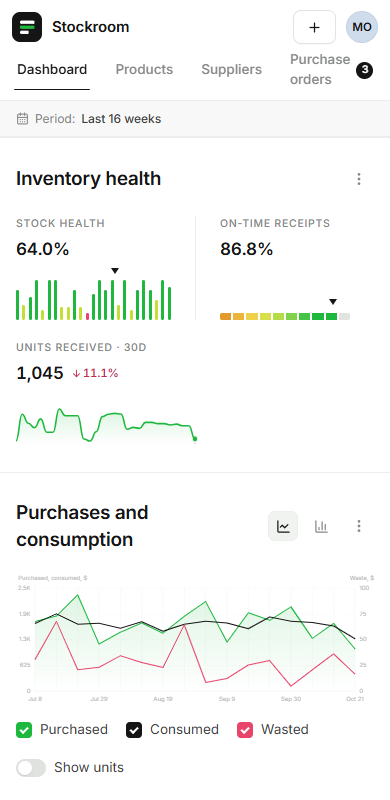 | 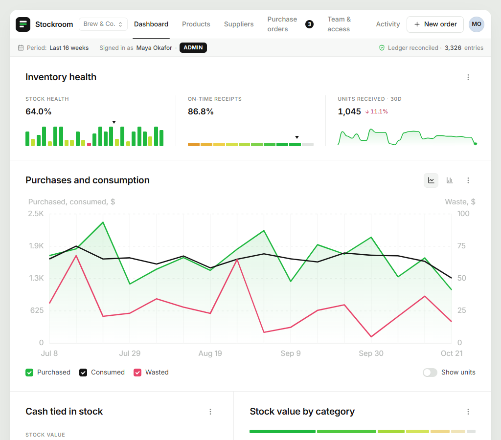 | 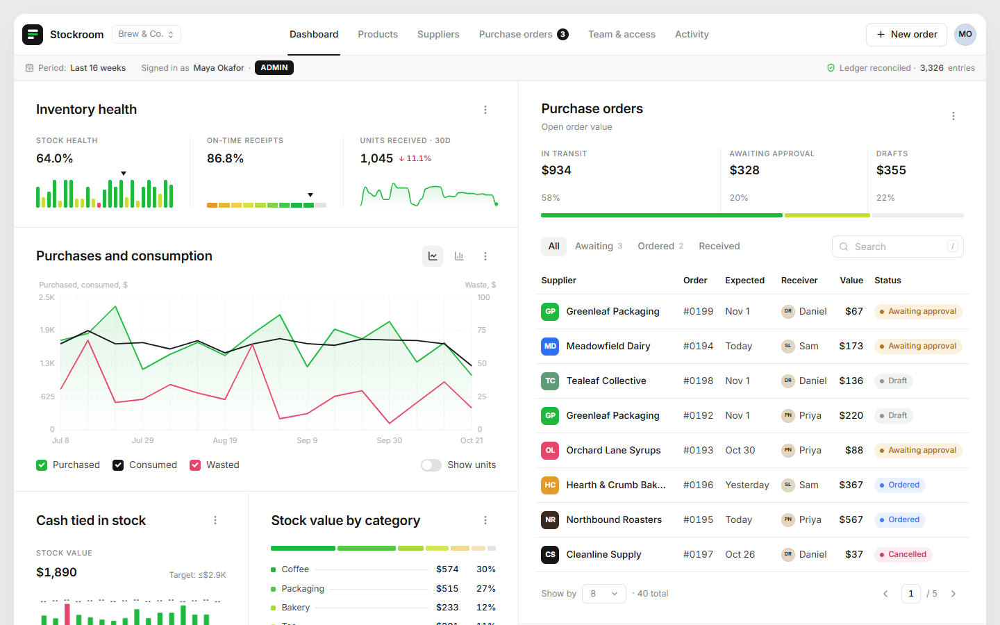 |
| Dashboard after | 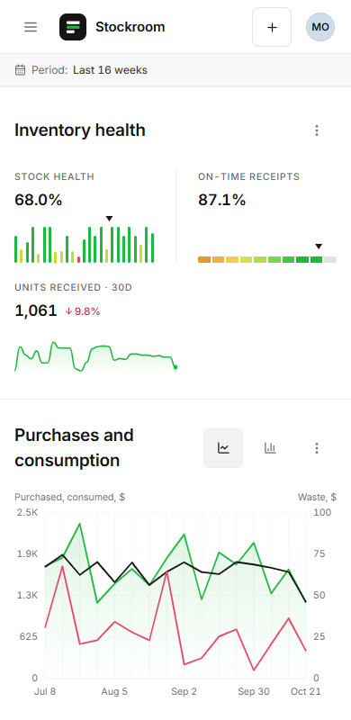 | 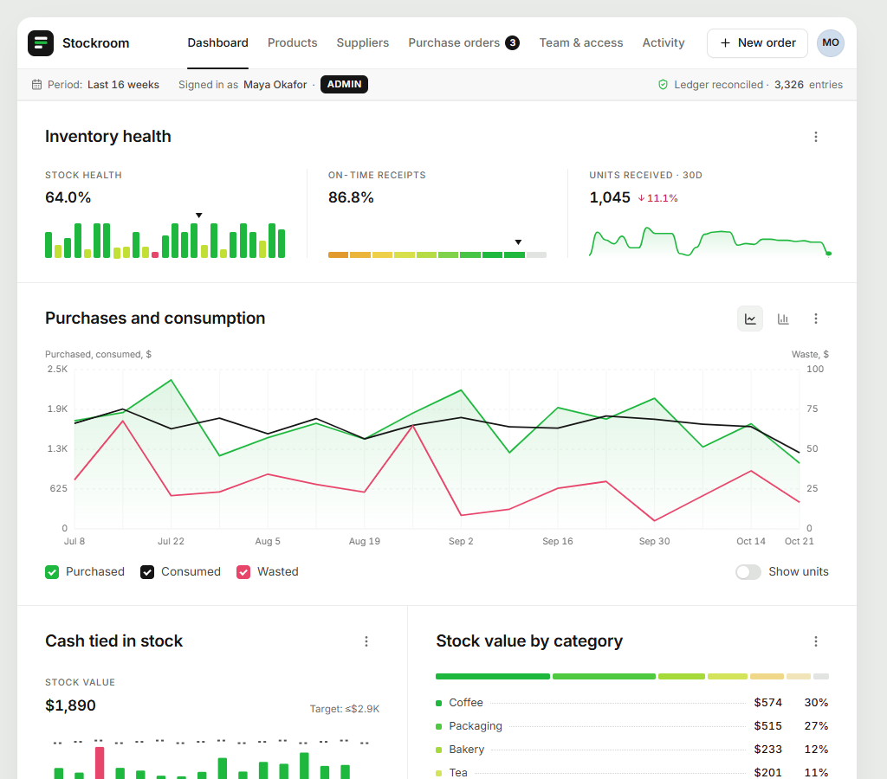 |  |
| PO detail before | 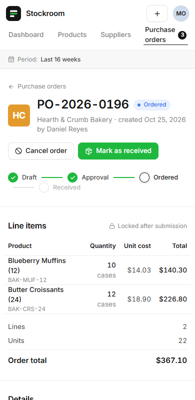 | 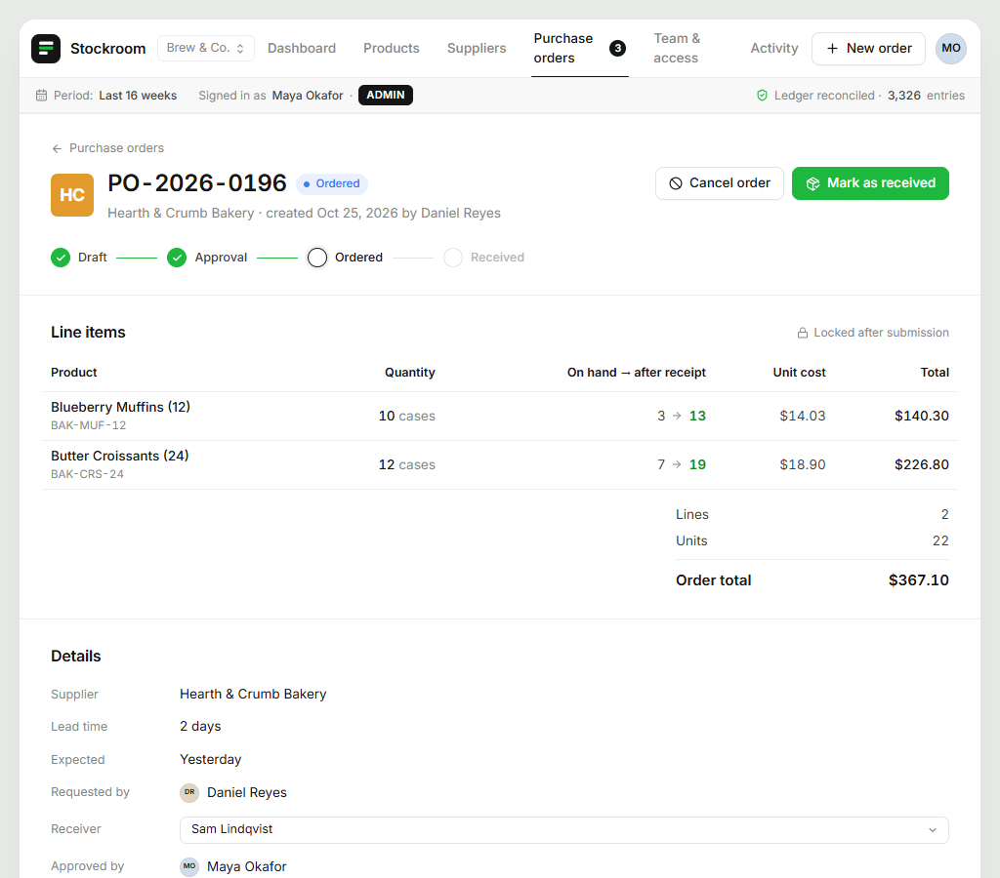 | 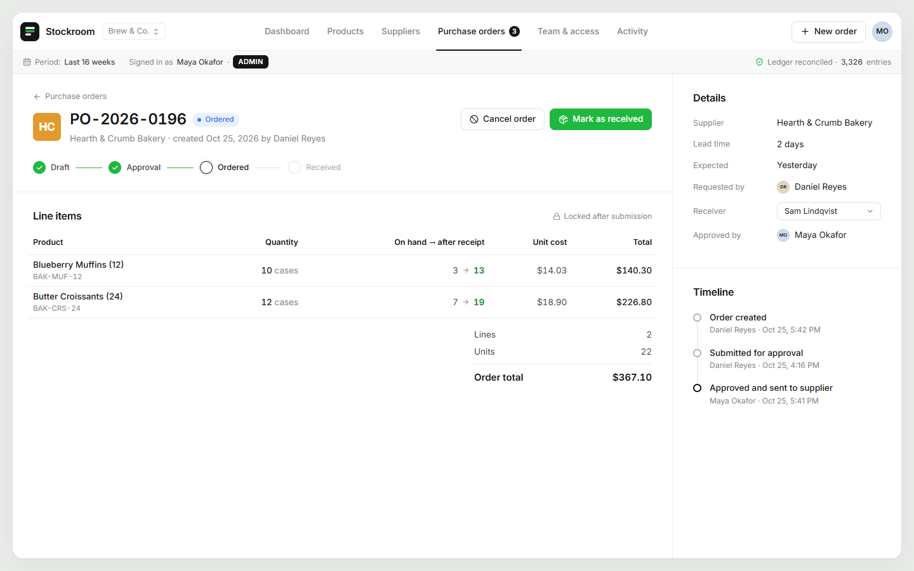 |
| PO detail after | 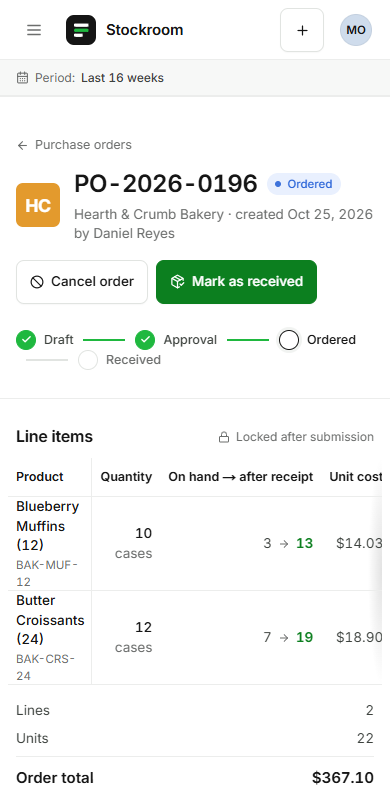 | 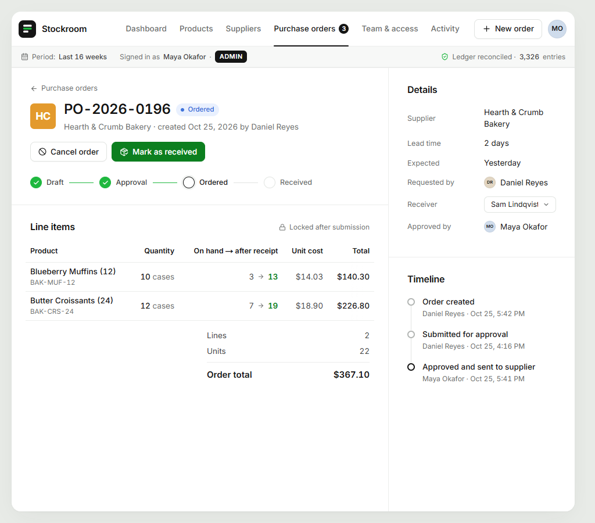 | 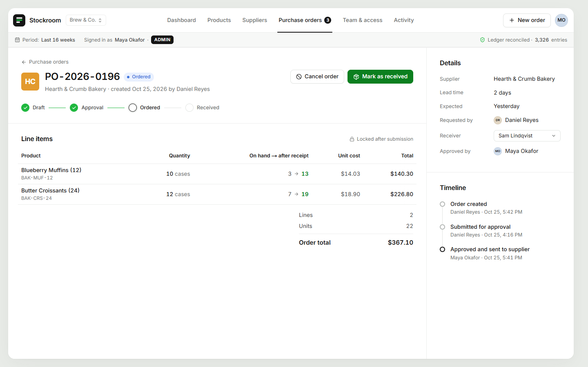 |
| PO form before | 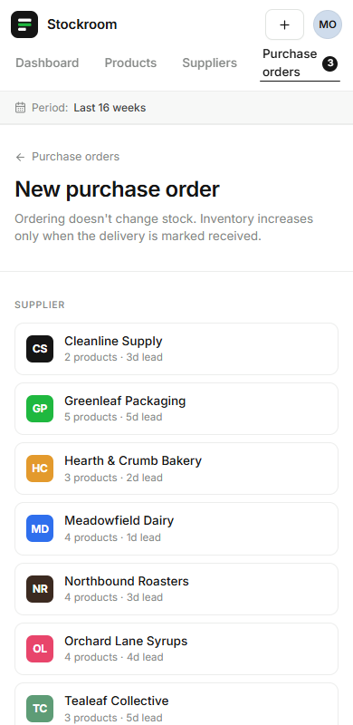 | 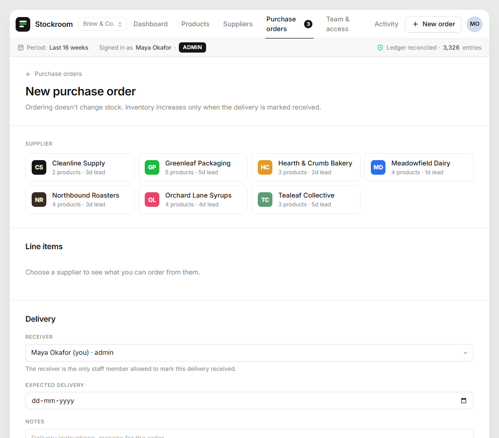 | 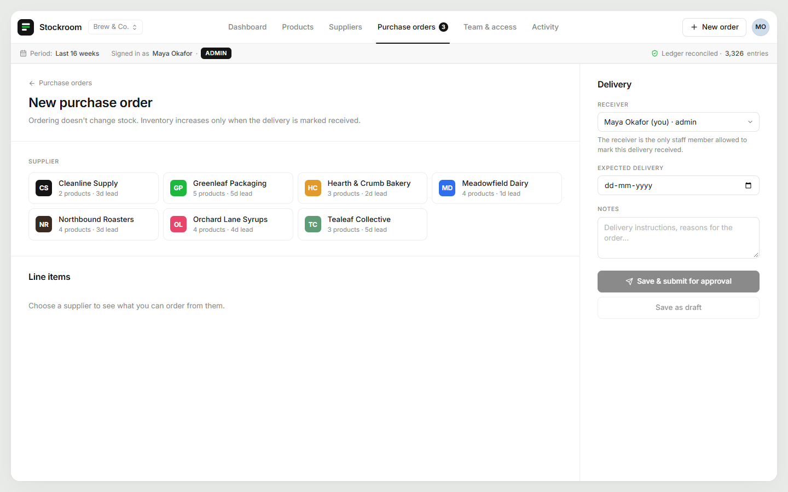 |
| PO form after | 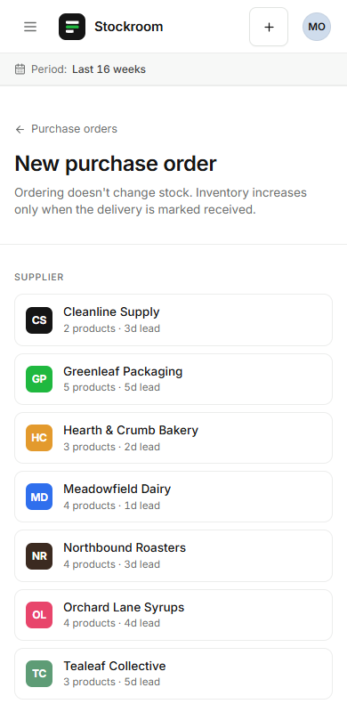 | 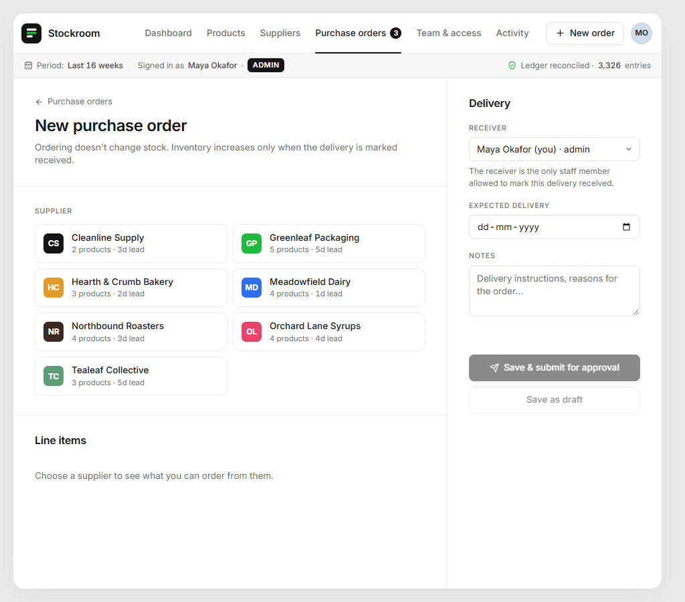 | 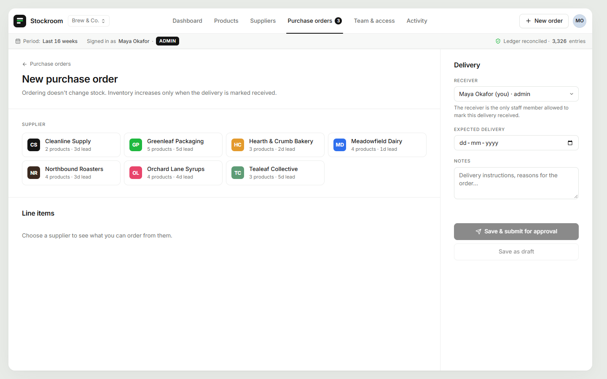 |

At 1440 the layout, type, colour and spacing match. The visible differences are deliberate:
- slightly darker grey text, pill text and green action button (contrast);
- a 15px scrollbar gutter that is now always reserved;
- "8 per page" instead of the page-size picker on the dashboard panel.

Below 1024, the tab strip becomes a menu button that opens a drawer.

## Acceptance criteria

- [x] **CLS < 0.05 on every page, all three roles.** Max load CLS 0.002; max interaction CLS 0.004.
- [x] **No horizontal page scroll at 360px.** 0 overflow runs across 175 (all pages, all roles, 360–1920).
- [x] **No content jump on refetch, hover, tab switch or route change.**
  - Refetch keeps content mounted (SWR).
  - Tab switches and pagination score 0, using fixed column layouts, full-page filler rows and per-view keys.
  - Hover never changes size; route re-entry shows no intermediate state.
- [x] **Charts don't re-animate on refetch; resize smoothly.**
  - Entrances run on first mount only (0 `draw-in` paths after mount); series toggles fade instead of remounting.
  - Width comes from a rAF-coalesced ResizeObserver inside fixed-height boxes.
- [x] **Every action has pending, success and error feedback.**
  - Busy buttons keep their width and ignore repeat clicks.
  - Success is a toast; errors appear in the dialog footer or the field's reserved line, plus a toast where relevant.
  - Failed loads show a retry.
- [x] **Reduced motion respected.** Measured: route fade, dialogs, drawer, menus, bars and collapse all drop to about 0s; count-up and highlights are off.
- [x] **Keyboard-only login → create PO → approve → receive.** `tools/keyboard-walkthrough.mjs` passes **20/20**:
  - a visible focus ring at every step;
  - focus trapped in dialogs (8×Tab);
  - focus returned to the page heading when the trigger disappears;
  - stock counts 10 → 18 on receive, with the timeline entry highlighted.
- [x] **All 9 backend tests pass; production build succeeds; no console errors or warnings.** 9/9; build OK; 0 console messages in the 175-run after-pass.
- [x] **Visual design unchanged at 1440**, apart from the deliberate deltas listed above.

## Contrast (WCAG AA, normal text ≥ 4.5:1)

| Pair | Before | After |
|---|---|---|
| Muted text on white / sub-bar / grey pill | 3.58 / 3.36 / 3.21 | **5.14 / 4.82 / 4.61** |
| Green ink on white / on green-soft (delta, manager badge, focus ring) | 4.49 / 4.02 | **5.16 / 4.62** |
| Lime, amber, blue pill text | 4.24, 4.07, 3.98 | **4.60, 4.66, 4.64** |
| White on green "Mark as received" button | 2.63 | **5.16** |
| Light grey used for text (axis labels, counts, placeholders, kbd hints) | 2.05 | now muted (≥4.6); light grey is decorative only |

All hues are the same; only the tones are darker.

## Chosen not to do (and why)

1. **No sidebar.** The approved design is a top tab bar. It stays at ≥1024 (the org switcher hides below
   1280 to make room). Below 1024 it becomes an off-canvas drawer. There's no icon sidebar to condense.
2. **Dashboard is 2 → 1 columns, not 3 → 2 → 1.** The frame caps at 1480px and the design is two columns.
   Inside, cards reflow on their own width (container queries): KPI rows and the cash/category split.
3. **Colour/background hover fades are kept (120ms).** They are paint-only, with no layout. Everything that
   moves uses only transform and opacity. Expand/collapse uses `grid-template-rows`, as specified.
4. **Paged tables always reserve a full page of height.** Short filtered lists show blank space under
   the rows. That's the trade-off for zero movement on tab and page changes.
5. **Exit animation plays on Esc, backdrop click and ✕.** Dialogs closed by finishing their action
   (Save, Confirm) unmount at once, so the result shows without delay.
6. **Dashboard load CLS 0.002 remains.** The three open-order KPI widths become proportional once the
   values arrive (the design shows proportional widths), well under 0.05.
7. **Charts replay their entrance when you re-enter the route** (a new mount). They never replay on
   refetch, filter or series toggle.
8. **1024px with a mouse keeps the dense desktop controls.** 44px targets apply to touch (`pointer: coarse`)
   and to ≤767px. At 1024 with touch emulation off, 372 of 560 controls are under 44px by design.
9. **Long supplier names truncate on the dashboard panel**, with a hover tooltip, as in the baseline.

## Tooling added

- `tools/ux-audit.mjs <label> [--shots] [--quick]` runs the 175-run audit (CLS with shift sources, interaction
  CLS, re-entry height, overflow, tap targets, console) and saves screenshots.
- `tools/ux-compare.mjs before.json after.json` prints the comparison tables above.
- `tools/keyboard-walkthrough.mjs` runs the keyboard-only login → create → approve → receive flow. It
  creates real orders: running it added PO-2026-0200 and PO-2026-0201. `npm run seed` resets the demo data.
